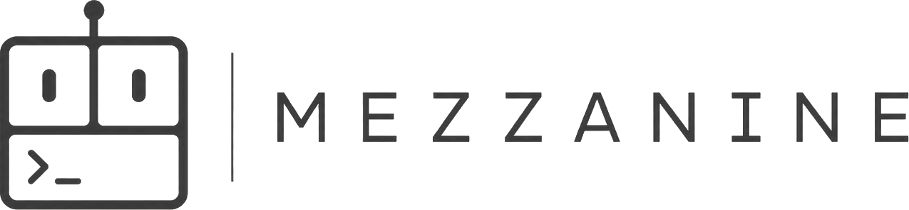
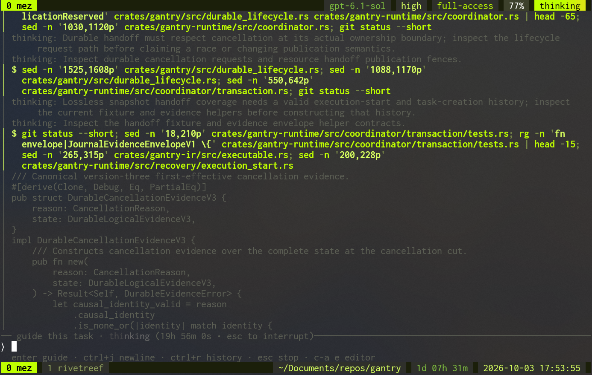

<div align="center">
<p align="center">
  <picture>
    <source
      srcset="./resources/mezzanine-combined-light.png"
      media="(prefers-color-scheme: dark)"
    />
    <source
      srcset="./resources/mezzanine-combined-dark.png"
      media="(prefers-color-scheme: light)"
    />
    
  </picture>
</p>
<p align="center">
  <a href="https://github.com/NFJones/mezzanine/stargazers"></a>
  <a href="https://github.com/NFJones/mezzanine/forks"></a>
  <a href="https://github.com/NFJones/mezzanine/issues"></a>
  <a href="https://github.com/NFJones/mezzanine/actions"></a>
  <a href="https://crates.io/crates/mezzanine"></a>
</p>
</div>

***

<div align="center">
<picture>
    
</picture>
</div>

***

Mezzanine is a terminal multiplexer with a built-in pane-local agent. Keep a
shell, logs, editor, and agent conversation together in one recoverable session
while you inspect, edit, and validate work.

In native mode, `/cd` moves the agent workspace independently of the pane
process. See [workspace navigation](docs/agent/commands-skills-and-macros.md#change-the-native-workspace)
for its scope and current limitations.

Published agent objectives update immediately; their optional saved-session
display mirrors use bounded background persistence so cache contention does not
freeze unrelated work. Joined children can ask their parent for clarification
before completing, even with one provider slot. Optional request-bound waits
also let a parent reassess an exact peer request after a reply or dependency
retirement. See
[messaging](docs/agent/subagents-and-messaging.md).

Agent logs can optionally show captured UTC occurrence times with bounded
fixed-width clock formats, without changing copied or model-facing content.
Timestamps default off; see [terminal appearance](docs/configuration/appearance-and-terminal.md).

Compaction validates summaries against frozen local allowances and complete
request fit, independently of provider generation controls. OpenAI requests
always omit `max_output_tokens`; see [context and continuity](docs/agent/context-and-continuity.md).
Forked subagents retain compacted summaries, including conversations with no
remaining raw history, before starting their first provider request.
Provider and native worker retirement settles the original claim, preserves
known usage and retains completed results for normal validation.

Shared HTTP execution keeps wire payloads out of transport diagnostics. The
[authenticated-search foundation](docs/reference-manual/agent-actions.md#http-execution-and-authenticated-search-foundation)
does not activate paid search or change the default backend.

Codex lifecycle observations include permission waits and tool activity.
Synchronous model hooks report available per-request usage under native readiness.
Fresh native lifecycle facts restore visibility after idle expiry.
Model readiness captures the native hook’s request directory for accounting.
Native child starts qualify separate request custody without changing parent status.
Shared-server callbacks require requesting-client association and cannot borrow
a launching pane’s context, including when the server uses stdio.
Claude child accounting requires a genuine start under the current parent observer.
Ordinary Claude accounting keeps missing-counter or delivery coverage visible
after earlier reported usage, without changing vendor requests or recorded expense.
Response-model metadata preserves bounded cloud model labels through durable replay.

Ordinary Pi accounting reports observed auxiliary counters with missing request
attribution as unavailable coverage while retaining supported assistant usage.
Fresh observations can redisclose that gap after receiver-side state loss.

Ordinary Pi/OpenCode integrations installed by bootstrap distinguish logical
retirement from verified durable source-end acknowledgment, with bounded
same-intent reply-loss recovery. Exhaustion remains unavailable; this does not
imply a durable inbox or cold-service recovery. Stored lifetime checkpoints alone
cannot renew or restore harness authority. Connected ordinary observers renew
optional lifetime metadata through bounded, freshly native-qualified maintenance;
this does not restore authority after full control-service replacement.
Initial public replay-fence metadata is stored without credentials; its presence
alone does not authorize observer takeover or cold recovery.
Retirement and its recovery stay bound to the original captured observer fence.
Qualified same-live observer handoff publishes its new fence through bounded
native metadata work; this still does not provide cold-service recovery.
Successful initial acceptance also returns a public historical source receipt,
not a credential or permission to recover a source.
The server supports explicitly requested same-native-source cold claims with
fresh proof and exact durable fencing. The shared persistent client retains
validated public checkpoints and can automatically recover after an answered
same-live refusal without changing an incurred report or recharging its replay.
Cold publication restores bounded committed observation partitions, including
models whose reports are not replayed. Pre-replacement pane reset persistence
remains separate unfinished accounting work; no never-received-data guarantee
is implied.

## Why Mezzanine?

- **A real multiplexer, not an agent wrapper:** persistent windows and panes,
  detach/reattach, copy mode, and recoverable terminal sessions keep your full
  workspace together.
- **An agent that lives where the work lives:** each pane gets its own
  independent, terminal-local conversation alongside the shell, editor, logs,
  or service it is helping you operate.
  Saved-conversation changes keep the pane's established messaging identity
  without reviving former delegation authority.
- **Actions you can inspect and control:** commands, patches, approvals, MCP
  calls, and subagent work are explicit rather than hidden behind a chat UI.
- **Agents that can coordinate, not just delegate:** discover peers, exchange
  scoped messages, contain malformed messaging peers to their connections, and
  keep persistent collaborators in dedicated panes with
  clear ownership and authority boundaries.
- **Remote access without giving up recovery:** optional Iroh connectivity uses
  explicit device pairing while the local Unix socket remains the administration
  and recovery path.
- **Safety is a first-class workflow:** project trust, approval policies, and
  optional OS-level confinement (Bubblewrap on Linux or Seatbelt on macOS) are
  separate, visible controls.

## Prerequisites

- Linux or macOS, with pseudoterminals and a POSIX-style shell.
- Rust 1.91 or newer when building from this repository.
- A usable `$SHELL`; Mez falls back to `/bin/sh` when it is executable.
- A provider account and supported sign-in method, or a configured compatible
  local backend, for model-backed agent work.

## Supported providers

Check your provider and authentication method before installing:

| Provider or backend | Support | Authentication and requirements |
| --- | --- | --- |
| OpenAI | Built-in, using the Responses API | Browser sign-in (default interactive flow), device-code sign-in, or API key. Model access depends on your account. |
| Anthropic | Built-in, using the Messages API | Anthropic Console API key. |
| DeepSeek | Built-in, using its Chat Completions API | DeepSeek API key. |
| OpenAI-compatible hosted or local backends | Configurable Responses or Chat Completions adapters | Configure the API base URL, models, and any credentials required by the backend. Compatibility depends on the endpoint and model. |

See [provider authentication](docs/getting-started/authentication.md) for sign-in
and credential handling, and the
[provider configuration reference](docs/configuration/reference.md#providersname)
for adapter options and an LM Studio example.

## Quick start

Clone the repository, then install the product package from its root:

```sh
git clone https://github.com/NFJones/mezzanine.git
cd mezzanine
cargo install --path crates/mezzanine --locked
```

Cargo normally installs `mez` in `~/.cargo/bin`. Ensure that directory is on
`PATH`, or invoke `~/.cargo/bin/mez` in the commands below.

Optionally create a baseline configuration, authenticate, and start Mezzanine
in a working directory. Starting a session creates the default configuration
when none exists:

```sh
mez config init
mez auth login
cd /path/to/repository
mez new
```

With an interactive terminal, the default OpenAI login flow prefers browser
sign-in. See
[Getting started](docs/getting-started/README.md) for other providers, API keys,
and noninteractive authentication, or the
[configuration reference](docs/configuration/reference.md) for backend options.

Press `Ctrl+A a` to open the focused pane's agent shell. Begin with a bounded
task that asks for inspection and focused validation. Press `Ctrl+A d` to detach
without normally stopping the session.

Agent entry can also work with an interactive shell reached through SSH or a
container, without requiring Mezzanine to be installed in that environment.
See [Agent shell: Work inside SSH and container
shells](docs/using-mezzanine/agent-shell.md#work-inside-ssh-and-container-shells)
for the required prompt boundary and bootstrap behavior.

## Everyday use

Use `mez new` to create a new session, `mez list` to discover resumable sessions,
and `mez attach` to return to one. In a running session, `Ctrl+A :` opens the
Mezzanine command prompt, `Ctrl+A ?` shows effective key bindings, and
`Ctrl+A a` toggles the agent shell.

Within an agent pane, plan-only mode is available when you want to review an
approach before allowing changes. See the [agent guide](docs/agent/README.md)
for its controls and behavior.

Mezzanine integrates with supported interactive shells while preserving their
normal startup and history behavior. See the shell and terminal documentation
for shell-specific behavior and nested-session setup: [Agent
shell](docs/using-mezzanine/agent-shell.md#choose-a-shell-mode) explains native
and pane execution, while [Terminal
compatibility](docs/reference-manual/terminal-compatibility.md) defines the
implemented terminal surface.

After you explicitly open the agent shell at an empty interactive prompt,
Mezzanine discovers and bootstraps nested SSH or container environments without
installing anything inside them. It does not inject into password prompts,
full-screen programs, or uncertain command lines, reuse local startup files, or
silently modify remote shell configuration.

After upgrading Mezzanine, open a new pane or restart the session to use
updated shell integration.

For a service-manager deployment, `mez host serve` runs the persistent
multi-session host. Isolated optional Iroh network setup failure or endpoint loss
preserves local sessions and Unix administration after proven remote cleanup. Optional Iroh access uses explicit
device pairing and keeps the local Unix socket as the administration and recovery path. See [Persistent
multi-session host](docs/operations/persistent-host.md), [Remote pairing and
recovery](docs/safety-and-trust/remote-pairing-and-recovery.md), and [Operations
and troubleshooting](docs/operations/README.md).
Service supervision preserves the initiating failure alongside bounded, named
cleanup diagnostics. Host stop reports failed durability even when
remaining session cleanup completes.

Use `mez --help` and the [CLI reference](docs/reference-manual/cli.md) for the
current command contract. Use [Sessions and panes](docs/using-mezzanine/sessions-and-panes.md)
and [Terminal input, copy, and history](docs/using-mezzanine/terminal-input-copy-and-history.md)
for in-session work.

### Shell completion

Generate shell completions from the installed `mez` binary. For the current zsh
session, run:

```sh
source <(mez completion zsh)
```

The same process-substitution form works for Bash with `bash` in place of
`zsh`. Fish, Elvish, and PowerShell use different loading conventions; generate
their definitions with `mez completion <shell>` and install the output according
to that shell's completion documentation. Supported shell names are `bash`,
`elvish`, `fish`, `powershell`, and `zsh`.

## Safety at a glance

The agent works from its pane's working directory, configured guidance, and
explicit action results. It does not passively receive your terminal screen,
scrollback, or other panes.

Approval policy controls whether Mezzanine permits an action. Optional OS-level
confinement separately limits what permitted local shell processes can access,
and web and integration actions have their own capability and approval gates.
Linux Bubblewrap uses private namespaces. macOS Seatbelt instead enforces
operation-level policy in the visible host namespace and is not namespace-
equivalent isolation. See the sandboxing manual for the exact boundary.

Review unfamiliar project overlays and applicable `AGENTS.md` files before
trusting their guidance. Project instructions can shape workflow but cannot
grant authority. See
[Safety, trust, and security](docs/safety-and-trust/README.md) for approval,
confinement, project-trust, and audit guidance.

## Documentation

The [Mezzanine manual](docs/README.md) is organized by task and audience:

- [Getting started](docs/getting-started/README.md)
- [Using Mezzanine](docs/using-mezzanine/README.md)
- [Agent and integrations](docs/agent/README.md)
- [Safety, trust, and security](docs/safety-and-trust/README.md)
- [Configuration](docs/configuration/README.md)
- [Operations and troubleshooting](docs/operations/README.md)
- [CLI, key, action, and terminal reference](docs/reference-manual/README.md)
- [Contributor documentation](docs/contributing/README.md)

[SPEC.md](SPEC.md) remains the normative behavior and compatibility contract.
[AGENTS.md](AGENTS.md) contains repository workflow requirements for contributors.

## License

Mezzanine is licensed under the [Apache License 2.0](COPYING).
